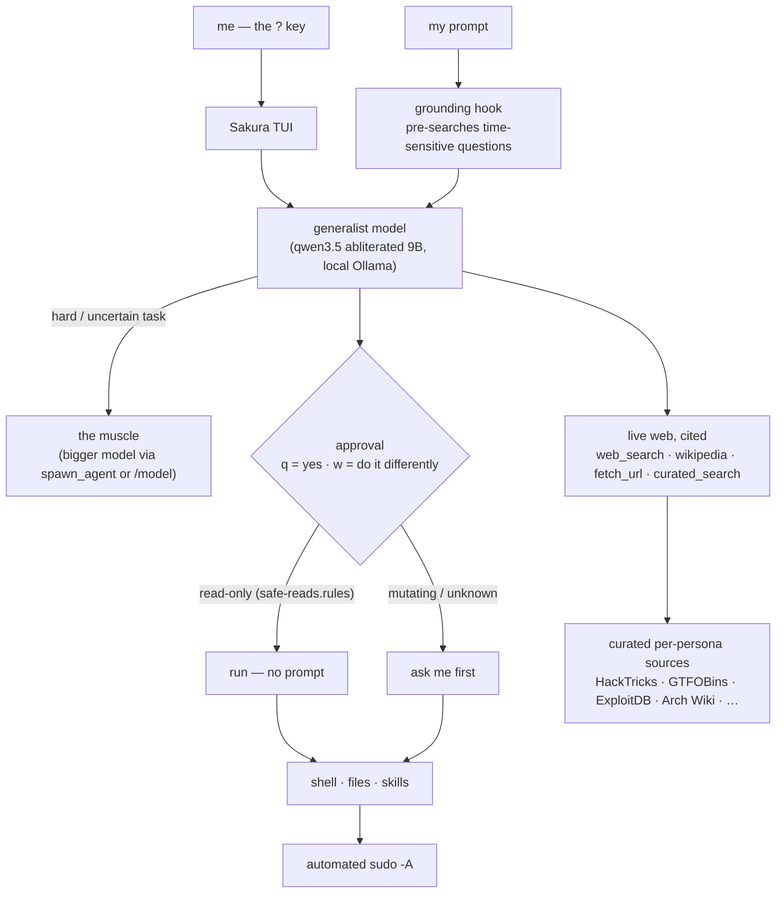

<div align="center">

# 🌸 Sakura

### Claude Code at home — a fully-local, uncensored terminal agent that acts.

[](#)
[](#)
[-000000?logo=ollama&logoColor=white)](#)
[](#)
[](#)
[](LICENSE)

*by [Nobel Dahal](https://github.com/coderkoala)*

</div>

---

## Why I built this

I live in the terminal across seven-plus machines, and I wanted the thing I actually use — an agent that
*does the work* — without shipping my keystrokes to someone else's cloud, without a model refusing my own
authorised security work, and without paying per token to be lectured. So Sakura runs entirely on my own
hardware on local Ollama models, it never asks permission from a vendor, and it is mine to shape.

The design rules, non-negotiable:

- **Local and private.** Nothing leaves the box except the model's own web lookups and my SSH.
- **It acts, I steer.** It runs commands, edits files and chains multi-step tasks. I confirm or redirect each
  risky step with a single keystroke — `q` to approve, `w` to say *"no, do it this way instead"* and hand it
  a correction. Read-only commands never stop me.
- **Uncensored.** My machine, my code, my network, my targets. No refusals, no moralising.
- **Honest about its limits.** The fast generalist answers what it knows and visibly escalates to a bigger
  "muscle" model when a task is above its pay grade, instead of bluffing.
- **Current, not stale.** For anything that changes over time it searches the live web and cites the source,
  rather than reciting a year-old training cutoff.
- **Version-controlled, always.** Everything here auto-syncs across all my devices.

Sakura is my fork of [Open Interpreter](https://github.com/OpenInterpreter) (the Rust `codex-rs` engine),
rebranded and bent to these rules. The binary is built from that fork; this repo is Sakura's brain — its
config, its global instructions, its exec-policy, its tools and its skills.

## How it fits together



## What's built

- **The agent.** Rebranded Open Interpreter fork → `sakura` (and `?`). Config home `~/.sakura`. Local Ollama,
  `chat` wire API. Generalist → muscle escalation (`spawn_agent` / `/model`).
- **Approval UX.** Prompt-everywhere (`q` approve / `w` "do it differently"); `safe-reads.rules` auto-runs
  ~80 read-only commands so only mutating or unknown ones stop me. Automated `sudo -A` (askpass + NOPASSWD).
- **Live, cited knowledge.** A zero-dependency `sakura-web` MCP server **and** matching shell CLIs —
  `web_search`, `wikipedia`, `fetch_url`, `curated_search` — every result carries source URLs. A
  `UserPromptSubmit` hook pre-searches time-sensitive questions and grounds the model so it stops answering
  current-fact questions from a stale cutoff.
- **Curated sources per persona.** Each specialist searches its own authoritative sites — security personas hit
  HackTricks / GTFOBins / ExploitDB / MITRE, sysadmins hit the Arch Wiki / man7, and so on
  (`mcp/sakura-web/sources.json`).
- **Skills.** 39 specialist personas: office/student (xlsx, docx, pptx, pdf with safe page breaks,
  step-by-step spellcheck), the full offensive-security suite, OSINT, reversing, forensics, networking,
  databases, media and translation.
- **Memory.** Say *"remember"* and it saves a durable fact. Two small plain-text stores, capped at 3200 characters between them, load into every new session. A full store refuses the write, so the agent has to choose what to drop. Secrets and instruction-like text are refused on the way in and withheld again on load, because a sync can change the files. `sakura-recall` searches past conversations with SQLite full-text search, no model involved. The design follows the ideas in [Hermes Agent](https://github.com/NousResearch/hermes-agent)'s memory, written from scratch for a 32k context.
- **What's true right now.** A small local model's training is always out of date, so `live` asks the sources that publish the answer: news feeds, weather, exchange rates, vulnerabilities and whether they're being exploited, release notes, support dates, papers and statistics. No keys or accounts, and every answer carries its source and date. The router injects the right lookup before the model answers, so it doesn't have to remember to look. `live research` searches and reads the top pages in one step. Your question's terms reach the source being asked, such as Open-Meteo or GitHub, so a lookup isn't private from that source.
- **Web access, all on your machine.** `sakura-web-setup` adds a local SearXNG for search (your queries reach the search engines it asks, and nothing else does), main-text extraction, and a headless browser for pages built by JavaScript. No account, API key or third-party service. A site that refuses is taken at its word: Sakura reports it and uses another source, or asks you.
- **A browser you share with it.** `sakura-browser` drives a window on your screen that keeps its logins, and shows the agent a numbered list of what it can click or type in. CAPTCHAs, human checks and passwords stay yours: the agent has no elements to act on while a check is up, can never type a password, and asks you, then carries on once you've dealt with it.
- **Its own documents.** `rag` searches your files by meaning and keywords, with local embeddings on the CPU. Nothing leaves the machine, and secrets and generated folders are skipped.
- **Careful with files and context.** `view_file` pages through a file with line numbers. `edit_file` changes exact text and refuses if it doesn't match exactly once. When command output would overflow a small context, the engine cuts the oldest output to its ends before it can crash the session.
- **Tools it grows itself.** When you ask for a command that should last and nothing installable does the job, Sakura writes a script and runs `sakura-tool keep`. The script's own check runs three times in an empty directory: it has to fail without the tool, fail against a stand-in that does nothing, and pass with the real one. Kept tools come last on PATH, so one can't stand in for a real command, and the prompt lists them in later sessions. A guard refuses scripts written straight into a PATH directory, and a Stop hook sends the turn back if a script you asked to keep wasn't kept. This is for explicit requests today: it doesn't reliably decide to keep a tool unprompted.
- **Coordinator.** `??` opens a session that holds the plan and never touches the work: a guard refuses anything that changes something. It hands each change to `sakura-worker`, a disposable run in a fresh context that returns a short report. A job passes only if your verify command exits 0, so the worker can't talk its way through, and a failure goes to a new worker. The plan survives compaction in a state file. Any session can call a worker too.
- **GPU.** A driver module that actually works: graphics-drivers PPA, the full build/DKMS prereq stack,
  per-kernel module builds, Secure-Boot MOK enrolment, `nvidia-drm.modeset` + initramfs.
- **Version control across devices.** `dotfiles-autosync` (systemd timer): commit → rebase → push, never
  force, notify on conflict — so Sakura follows me to every machine. Secrets stay `age`-encrypted.
- **Opinionated Linux stack.** `pass` (credentials), `himalaya` (email IMAP/SMTP), `notify-send` + `ntfy`
  (notifications), systemd `--user` timers (cron).

## Which model runs

`sakura-model plan` says what this machine runs and why. Where the hardware allows, `?` drives with Qwen3.6-35B-A3B
(abliterated, Q3_K_M): a Mixture-of-Experts model whose dense part and an expert cache sit in VRAM and whose other
experts stay in RAM, served by the `llama-server` that ships with Ollama. The VRAM budget is read from the machine, so
a desktop whose display holds VRAM gets a smaller cache. Anything else stays on the 9b on Ollama.

Run `sakura-model pull` once per device (15.6 GB, checksum verified): nothing downloads it for you. Without it, or if
the server can't start, `?` falls back to the 9b.

Measured on an RTX 4060 Laptop with 32 GB RAM, RAM and budget as noted (`evals/bench_server.py`, `evals/run.py`):

| | 9b | Qwen3.6, 5.3 GB VRAM | Qwen3.6, 7.3 GB VRAM |
| --- | ---: | ---: | ---: |
| Writing, warm | 43 tok/s | 50 tok/s | 72 tok/s |
| Writing after a 26K prompt | | 31 tok/s | 37 tok/s |
| Reading a long prompt | ~2,000 tok/s | 503 tok/s | 584 tok/s |

The lower budget stands in for a 6 GB card by limiting the cache; it hasn't run on a real one. Other models loaded by
`consult` compete for the same VRAM while this server is awake (it sleeps after 30 idle minutes).

## Roadmap

- Email: `sakura-mail-setup` is written but hasn't been run against a real mail server yet.
- A heavier muscle model as the hardware grows (the tiers are already config switches).

## Layout

| Path | What it is |
|------|------------|
| `config.toml` | The agent config: model, approval, keymap, memory, the `sakura-web` MCP server. |
| `AGENTS.md` | Global instructions — how it works with me, web-first for current facts. |
| `rules/` | Exec-policy: `safe-reads.rules` auto-allows read-only commands. |
| `skills/` | The 39 persona skills. |
| `mcp/sakura-web/` | The web-knowledge core (`webkit.py`), MCP server, curated `sources.json`. |
| `bin/` | `web_search` · `wikipedia` · `fetch_url` · `curated_search` CLIs. |
| `hooks/` | `web_ground.py` — the time-sensitive grounding hook. |

## Measuring it

```bash
python3 evals/run.py              # 31 cases, graded against live sources
python3 evals/ssh_chain.py        # ssh, pull and deploy on a throwaway container, graded inside it (needs docker)
python3 evals/coordinator.py      # workers and a coordinator session, graded by the repo's real state
```

## Install

Built for 8 GB of VRAM and up. Smaller cards are untested.

Linux with an NVIDIA GPU, Python 3.11+, git and [Ollama](https://ollama.com/download).

```bash
git clone https://github.com/coderkoala/sakura && cd sakura
./install.sh                                   # tells you what's still missing
ollama pull huihui_ai/qwen3.5-abliterated:9b
# the engine comes from the release; to build it yourself: SAKURA_NO_BINARY=1 and patches/README.md
sakura-launch
```

`sakura-model plan` says which driver your machine can run, and `sakura-model pull` fetches the bigger one (15.6 GB).
To add your own notes for the agent, put them in `~/.config/sakura/profile.md` and run `./install.sh` again.

## Credit

Built on [Open Interpreter](https://github.com/OpenInterpreter) / the `codex-rs` engine. Everything in this
repo — the rules, the tools, the skills, the branding — is mine.
