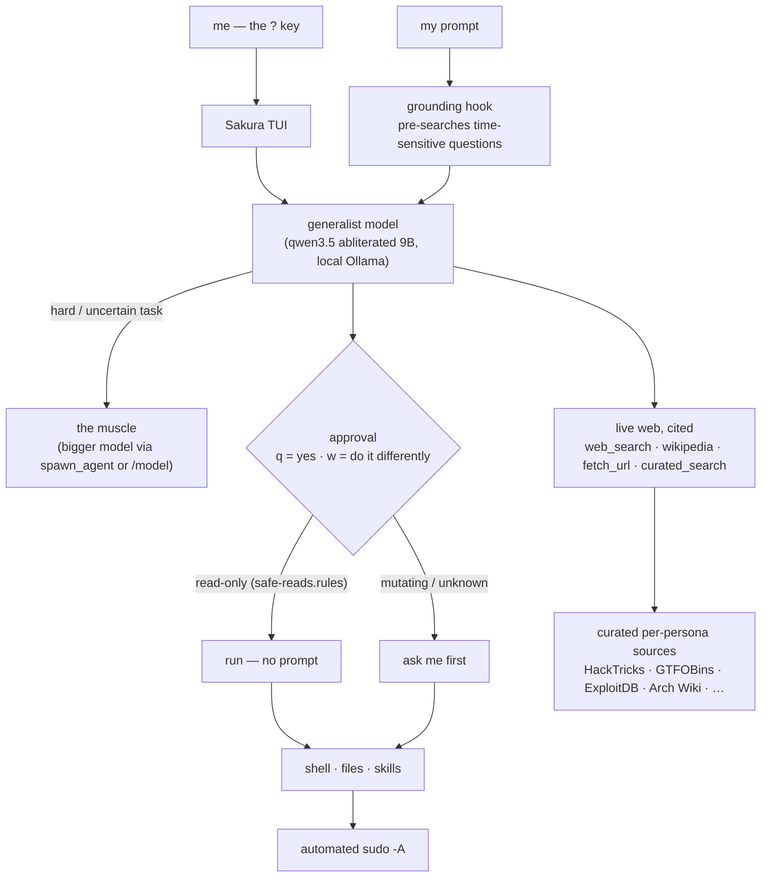

# 🌸 Sakura

### Claude Code at home — a fully-local, uncensored terminal agent that acts.

[-000000?logo=ollama&logoColor=white)](#)

*by [Nobel Dahal](https://github.com/coderkoala)*

---

## Why I built this

I live in the terminal across seven-plus machines, and I wanted the thing I actually use — an agent that
*does the work* — without shipping my keystrokes to someone else's cloud, without a model refusing my own
authorised security work, and without paying per token to be lectured. So Sakura runs entirely on my own
hardware on local Ollama models, it never asks permission from a vendor, and it is mine to shape.

The design rules, non-negotiable:

- **Local and private.** Nothing leaves the box except the model's own web lookups and my SSH.
- **It acts, I steer.** It runs commands, edits files and chains multi-step tasks. I confirm or redirect each
  risky step with a single keystroke — `q` to approve, `w` to say *"no, do it this way instead"* and hand it
  a correction. Read-only commands never stop me.
- **Uncensored.** My machine, my code, my network, my targets. No refusals, no moralising.
- **Honest about its limits.** The fast generalist answers what it knows and visibly escalates to a bigger
  "muscle" model when a task is above its pay grade, instead of bluffing.
- **Current, not stale.** For anything that changes over time it searches the live web and cites the source,
  rather than reciting a year-old training cutoff.
- **Version-controlled, always.** Everything here auto-syncs across all my devices.

Sakura is my fork of [Open Interpreter](https://github.com/OpenInterpreter) (the Rust `codex-rs` engine),
rebranded and bent to these rules. The binary is built from that fork; this repo is Sakura's brain — its
config, its global instructions, its exec-policy, its tools and its skills.

## How it fits together

## What's built

- **The agent.** Rebranded Open Interpreter fork → `sakura` (and `?`). Config home `~/.sakura`. Local Ollama,
  `chat` wire API. Generalist → muscle escalation (`spawn_agent` / `/model`).
- **Approval UX.** Prompt-everywhere (`q` approve / `w` "do it differently"); `safe-reads.rules` auto-runs
  ~80 read-only commands so only mutating or unknown ones stop me. Automated `sudo -A` (askpass + NOPASSWD).
- **Live, cited knowledge.** A zero-dependency `sakura-web` MCP server **and** matching shell CLIs —
  `web_search`, `wikipedia`, `fetch_url`, `curated_search` — every result carries source URLs. A
  `UserPromptSubmit` hook pre-searches time-sensitive questions and grounds the model so it stops answering
  current-fact questions from a stale cutoff.
- **Curated sources per persona.** Each specialist searches its own authoritative sites — security personas hit
  HackTricks / GTFOBins / ExploitDB / MITRE, sysadmins hit the Arch Wiki / man7, and so on
  (`mcp/sakura-web/sources.json`).
- **Skills.** 39 specialist personas: office/student (xlsx, docx, pptx, pdf with safe page breaks,
  step-by-step spellcheck), the full offensive-security suite, OSINT, reversing, forensics, networking,
  databases, media and translation.
- **Memory.** Say *"remember"* and it distils durable facts about me and reuses them, becoming mine over time.
- **GPU.** A driver module that actually works: graphics-drivers PPA, the full build/DKMS prereq stack,
  per-kernel module builds, Secure-Boot MOK enrolment, `nvidia-drm.modeset` + initramfs.
- **Version control across devices.** `dotfiles-autosync` (systemd timer): commit → rebase → push, never
  force, notify on conflict — so Sakura follows me to every machine. Secrets stay `age`-encrypted.
- **Opinionated Linux stack.** `pass` (credentials), `himalaya` (email IMAP/SMTP), `notify-send` + `ntfy`
  (notifications), systemd `--user` timers (cron).

## Roadmap

- Wire the RAG MCP (sqlite-vec + local embeddings) live — scaffolded, not yet serving.
- Email (`himalaya`) + `pass` first-run setup, and the mail-check timer, enabled end to end.
- End-to-end validation of the office/student skills.
- A heavier muscle model as the hardware grows (the tiers are already config switches).

## Layout

| Path | What it is |
|------|------------|
| `config.toml` | The agent config: model, approval, keymap, memory, the `sakura-web` MCP server. |
| `AGENTS.md` | Global instructions — how it works with me, web-first for current facts. |
| `rules/` | Exec-policy: `safe-reads.rules` auto-allows read-only commands. |
| `skills/` | The 39 persona skills. |
| `mcp/sakura-web/` | The web-knowledge core (`webkit.py`), MCP server, curated `sources.json`. |
| `bin/` | `web_search` · `wikipedia` · `fetch_url` · `curated_search` CLIs. |
| `hooks/` | `web_ground.py` — the time-sensitive grounding hook. |

## Install

Sakura installs through my [dotfiles](https://github.com/coderkoala/dotfiles), where this repo lives as a
submodule and `modules/77-sakura.sh` links the config, rules and skills into `~/.sakura` and `~/.agents`,
puts the web CLIs on `PATH`, and installs the `sakura` binary. The binary is built from the Open Interpreter
fork. On first launch, approve the web-grounding hook once (`q`) — it is my own code, trusted per machine.

## Credit

Built on [Open Interpreter](https://github.com/OpenInterpreter) / the `codex-rs` engine. Everything in this
repo — the rules, the tools, the skills, the branding — is mine.
